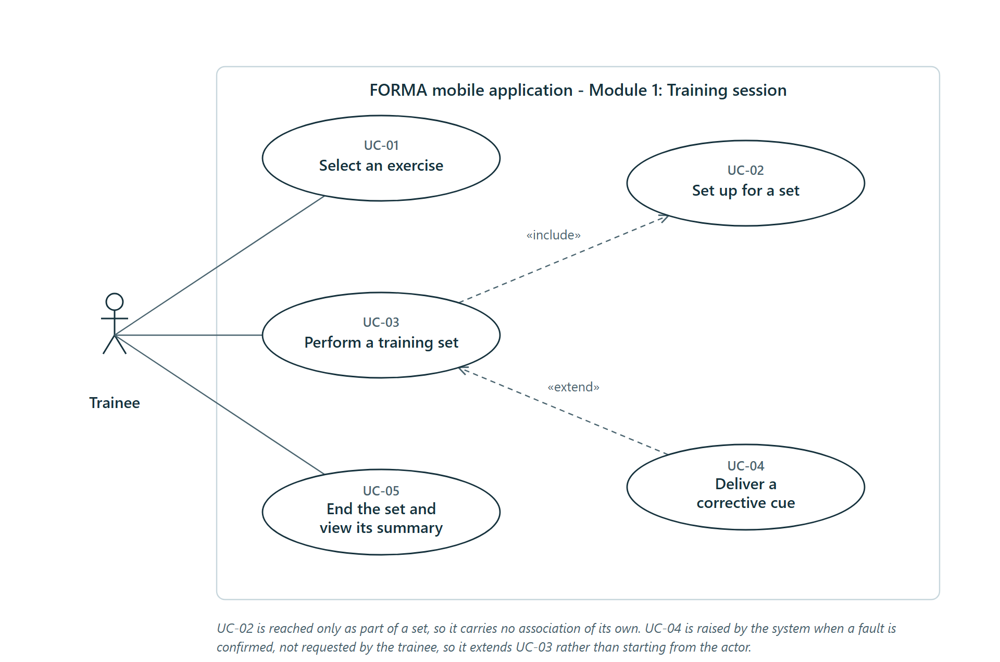
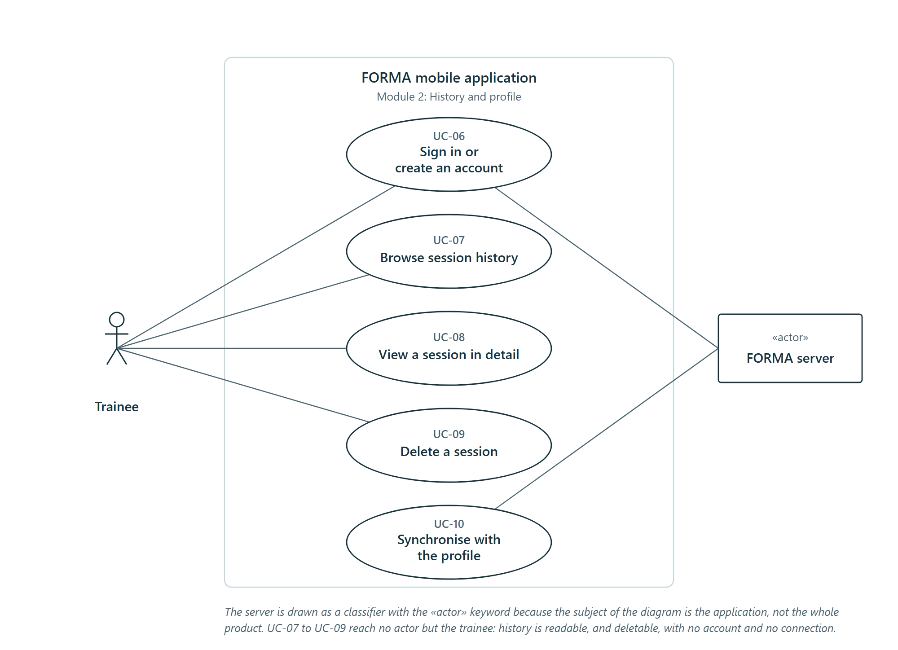

# Chapter 3 - Requirements

## 3.1 Users and Actors

**Trainee.** The only human actor. They select the exercise, perform the
movement, hear the cues, and review what the session recorded.

**FORMA server.** A secondary actor: the subject of the use-case model is the
mobile application, and the server is something the application talks to. It
holds the user profile and the session history, and it appears in two use
cases.

## 3.2 Use Cases

Ten use cases, in two modules. The split is the one the product presents to the
user: what happens during a set, and what happens to the record afterwards.

**Table 3.1** The use cases, by module and by who starts them

| ID | Use case | Module | Initiated by |
|---|---|---|---|
| UC-01 | Select an exercise | 1 | Trainee |
| UC-02 | Set up for a set | 1 | Included in UC-03 |
| UC-03 | Perform a training set | 1 | Trainee |
| UC-04 | Deliver a corrective cue | 1 | The system, on a confirmed fault |
| UC-05 | End the set and view its summary | 1 | Trainee |
| UC-06 | Sign in or create an account | 2 | Trainee |
| UC-07 | Browse session history | 2 | Trainee |
| UC-08 | View a session in detail | 2 | Trainee |
| UC-09 | Delete a session | 2 | Trainee |
| UC-10 | Synchronise with the profile | 2 | The application, when connected |

### 3.2.1 Module 1: the training session

**Figure 3.1** Use cases of Module 1. The subject of the diagram is the mobile application, which in this module communicates with no other system at all.

UC-03 is the central use case and the only one with a hard timing constraint.
Two relationships carry meaning here and both are worth stating.

UC-02 is included rather than associated. Setting up happens every time a set
is performed and never on its own. It is part of performing a set, not
something the trainee does for its own sake. It does not gate the set:
it shows the exercise, reports the framing and hands the decision to start to
the trainee.

UC-04 extends UC-03 and has no actor association. A cue happens when a fault is
confirmed and at no other time. That makes it conditional, which is what an
extension is. The system raises it; the trainee does not ask for it. That is
why no line reaches it from the actor.

### 3.2.2 Module 2: history and the profile

**Figure 3.2** Use cases of Module 2. Only two of the five reach the server, and the three the trainee uses most reach it not at all.

A record held only on the device is lost with the device, and a trainee who
changes phones after a year of training loses the year. That is what the
profile is for.

UC-07, UC-08 and UC-09 connect to the trainee alone. Browsing the history, opening a session and
deleting one all work with no account and no connection, because the device
already holds the records it wrote. Signing in adds durability and a second
device; it is not the price of using the product.

UC-10 is drawn with an association to the server and none to the trainee,
because it is not something the user does. The application performs it when it
is signed in and finds a connection, and the user's involvement ends at having
signed in once.

### 3.2.3 Scenario: UC-03, perform a training set

**Table 3.2** UC-03, perform a training set: actors, preconditions and postcondition

| | |
|---|---|
| Actor | Trainee |
| Precondition | An exercise is selected and its specification is loaded |
| Postcondition | A completed set is recorded on the device |

Main flow:

1. The trainee indicates that they are ready to begin.
2. The system shows how the exercise is performed: a diagram of the position
   the measurement is defined against, the camera placement the specification
   assumes, and what each fault will ask for. It is shown the first time an
   exercise is chosen and on request after that.
3. The system starts the camera and the pose pipeline and reports the framing
   conditions declared in the specification: whether the required landmarks are
   visible, whether the viewing angle is within tolerance, and whether the body
   occupies an acceptable part of the frame. When a condition fails it states
   the correction needed on screen and goes on reporting it. The trainee
   starts the set when they choose to.
4. The system announces the start of the set.
5. For each frame, the system computes the repetition driver declared in the
   specification and evaluates the fault conditions scoped to the current phase
   of the movement.
6. On a completed repetition, the count is incremented, and any fault the
   specification declares as a property of the repetition is decided at that
   boundary.
7. When a fault condition holds across the confirmation window and the trigger
   policy permits speech, the system extends into UC-04 and speaks one cue.
8. Steps 5 to 7 repeat until the trainee ends the set.
9. The system stops the pipeline and proceeds to UC-05.

Alternate flows:

**Table 3.3** UC-03 alternate flows: what the system does when a step cannot proceed

| | Condition | Behaviour |
|---|---|---|
| A1 | The trainee leaves the frame, or landmarks are lost | Counting is suspended and the system says so once. It resumes automatically. Repetitions during the gap are not counted, and the gap appears in the summary |
| A2 | Two faults hold within the same repetition | Both are recorded. The trigger policy selects at most one to speak |
| A3 | A confirmed fault has no authored cue | The fault is recorded and nothing is spoken. The summary reports it |
| A4 | The repetition driver is ambiguous, for example the trainee pauses mid-movement | No repetition is counted until the driver crosses its hysteresis bound |
| A5 | The sustained frame rate falls below the floor in NFR-P2 | The system says so, and the set is recorded as degraded rather than reported as an ordinary result |
| A6 | The application is interrupted, for example by an incoming call | The set ends and is recorded as incomplete, with the partial count preserved |

Step 3 reports rather than refuses, and the reason is practical before it is
philosophical. The trainee has to be at the phone to press start. A check
performed before that measures the framing of somebody standing beside the
camera, which is not the framing of the set. A gate placed there buys very
little and costs the trainee a product that decides whether they are allowed
to train. What camera placement does bound is what the assessment can see, so
the condition is stated plainly and goes on being stated. A2, A3 and A5 share
the principle: where the system has less information than it needs, it says
so rather than producing an answer anyway.

### 3.2.4 Scenario: UC-10, synchronise with the profile

**Table 3.4** UC-10, synchronise with the profile: actors, preconditions and postcondition

| | |
|---|---|
| Actor | FORMA server, as a secondary actor. The application initiates |
| Precondition | The trainee is signed in |
| Postcondition | The device and the profile hold the same set of sessions |

Main flow:

1. The application observes that a connection is available and that records
   exist which the profile has not acknowledged.
2. The application sends those records. Each carries the exercise, the
   specification version in force, the repetition count, the fault codes with
   their counts, and the timestamps. No frame and no image is sent, because
   none was ever kept.
3. The server writes each record under the user profile against an identifier
   generated on the device, so that a record already held is replaced rather
   than added a second time.
4. The application sends deletions made while offline, and the server removes
   the corresponding records.
5. The server returns records held in the profile that this device does not
   have.
6. The application marks the local records as acknowledged.

Alternate flows:

**Table 3.5** UC-10 alternate flows

| | Condition | Behaviour |
|---|---|---|
| B1 | The connection drops part way through | Records that were not acknowledged stay unacknowledged and are sent again later. Step 3 is keyed by identifier, so resending cannot duplicate |
| B2 | A session was deleted on one device and is still present in the profile | The deletion is applied. A record the user removed does not return |
| B3 | The trainee is not signed in | No synchronisation happens, and the device keeps a complete history of its own |

B1 is the reason step 3 is written the way it is. Synchronisation over a mobile
connection fails part way through as a matter of routine rather than as an
exception, so the protocol has to be safe to repeat. Making the write replace
rather than append costs nothing and removes the whole class of failure in
which a retry doubles a user's training history.

## 3.3 Functional Requirements

Each requirement is written so that it can be shown to hold or not to hold. The
final column traces it to an objective from 1.3: O1 on-device perception, O2
movement assessment, O3 immediate spoken feedback, O4 the application, the
server service and the user profile, O5 traceable fault definitions and a
labelling protocol, O6 a labelled dataset and a testing procedure.

### 3.3.1 Module 1: the training session

**Table 3.6** Functional requirements for the training session

| ID | Requirement | Serves |
|---|---|---|
| FR-01 | The trainee can select an exercise from those whose specification is loaded | O2 |
| FR-02 | The system evaluates camera framing before and during a set and states the correction needed when the framing is not usable, without preventing the set from starting | O1 |
| FR-03 | The system judges a repetition against the absolute criteria declared in the specification, with no measurement of the trainee taken beforehand | O2, O5 |
| FR-04 | The system estimates body pose from the camera feed in real time, entirely on the device | O1 |
| FR-05 | The system segments repetitions and maintains a live count for the current set | O2 |
| FR-06 | The system detects the technique faults declared in the active specification | O2, O5 |
| FR-07 | The system speaks a corrective cue, drawn from a bank of pre-authored lines, while the trainee is still performing the set | O3 |
| FR-08 | The system applies a trigger policy that governs when it speaks and when it stays silent | O3 |
| FR-09 | The trainee can end a set and see a summary of repetitions and faults | O2 |
| FR-10 | The system records the completed set on the device, whether or not a network is available | O4 |
| FR-28 | Before a set the system shows how the exercise is performed: the position the measurement is defined against, the camera placement the specification assumes, and what each fault asks for. It is shown the first time an exercise is chosen, can be dismissed for that exercise, and can be reopened from the set-up screen | O3, O5 |

### 3.3.2 Module 2: history and the profile

**Table 3.7** Functional requirements for history and the profile

| ID | Requirement | Serves |
|---|---|---|
| FR-11 | The trainee can create an account and sign in | O4 |
| FR-12 | The trainee can browse past sessions in reverse chronological order, with no account and no connection | O4 |
| FR-13 | The trainee can open a session and see, per set, the repetitions, the faults and their counts | O4 |
| FR-14 | The trainee can see, for any fault, its plain-language description, what to do differently next time, and the source its definition came from | O5 |
| FR-15 | The trainee can delete a session | O4 |
| FR-16 | When signed in and connected, the system synchronises locally recorded sessions to the user profile, and repeating a synchronisation does not duplicate a record | O4 |
| FR-17 | A deletion made while offline is applied to the profile at the next synchronisation, and the record does not return | O4 |
| FR-18 | Signing in on a device makes the profile's session history available on that device | O4 |

### 3.3.3 Cross-cutting

**Table 3.8** Cross-cutting functional requirements

| ID | Requirement | Serves |
|---|---|---|
| FR-19 | The system loads exercise definitions from specification files, with no change to application code | O2 |
| FR-20 | Every function in Module 1 operates with no network available | O1, O3 |
| FR-21 | No camera frame is written to storage, and no image data leaves the device | O1 |
| FR-22 | Only derived results leave the device: counts, fault codes, timestamps and specification versions | O1, O4 |
| FR-23 | A specification that fails validation is rejected when it is loaded, with the failure named, rather than loaded in part | O2 |
| FR-24 | Every fault a specification declares resolves to an audio asset, checked when the specification is loaded rather than discovered as silence during a set | O3 |
| FR-25 | Every fault a specification declares carries a provenance record | O5 |
| FR-26 | A session record stores the specification version in force when the set was performed, and the per-repetition detail behind its fault counts | O5, O6 |
| FR-27 | Where the system cannot support a result it says so instead of producing one. Loss of pose suspends counting and is announced, and a frame rate below the floor is reported | O6 |

FR-03 replaced a requirement for a per-user calibration step. That step was
removed from the design, for the reasons 4.5.1 gives, and the requirement went
with it rather than being carried and missed. NFR-P6, which bounded how long
the calibration could take, is gone for the same reason and leaves a gap in
the numbering rather than renumbering requirements that other chapters cite.

The specification format cannot express a fault without a provenance record, so
FR-25 is checked by the parser rather than resting on the author remembering
it.

FR-22's list is exhaustive: if a field is not on it, it does not leave the
device.

## 3.4 Non-Functional Requirements

### 3.4.1 Deriving the response-time requirement

The governing quantity is how long the system may take between a fault becoming
present in the movement and the trainee hearing about it. Every other
performance requirement in this chapter follows from it.

Three inputs go into it.

The first is the movement. A controlled bodyweight squat repetition takes two
to three seconds, and the descent is roughly half of that. The derivation uses
the faster end, one second of descent, because a requirement derived from the
slower end would be satisfied by accident.

The second is what a cue is for. A cue exists to change the repetition it
describes, which means it has to arrive while the trainee is still in the phase
in which the fault occurred. A depth cue heard during the ascent is describing
a descent that is over.

The third is that the larger share of that phase belongs to the trainee, not to
the system. They have to hear a short phrase, recognise it, and begin to act on
it, and that is not instantaneous.

From these, the rule the budget is built on: the system may consume at most a
third of the phase in which the fault occurs, leaving two thirds to the person
who has to respond. A third of a one-second descent is a little over 330 ms, so
the requirement is set at 300 ms, which keeps a margin inside the
derivation rather than spending it.

That total is then allocated across the stages between the fault and the sound.

**Table 3.9** The response-time budget, allocated across the stages between fault and sound

| Stage | Allocation | What it covers |
|---|---|---|
| Confirming that the fault is real | 140 ms | Three frame intervals. The reason for three is below |
| Camera capture to the frame reaching the application | 30 ms | One frame period at a conventional capture rate |
| Frame preparation | 15 ms | Format and geometry, before inference |
| Pose inference | 45 ms | One forward pass over one frame |
| Constraint evaluation | 5 ms | Arithmetic over a few dozen points |
| Cue selection | 5 ms | A table lookup and the trigger counters |
| Audio dispatch to the first audible sample | 60 ms | A pre-rendered asset, with no synthesis in the path |
| Total | 300 ms | |

Only the total is a requirement. The split is a planning allocation, and a
stage that overruns is acceptable as long as another underruns, because what
the trainee experiences is the sum.

Two things in that table need their own argument.

The confirmation window exists because a fault has to be seen more than once
before it is worth speaking about. One frame is not evidence: a single noisy
landmark can satisfy any threshold. Two frames are not much better, because a
single outlier next to one true observation still carries the decision. Three
is the smallest number for which no single sample is decisive, and because it
is the smallest, it is also the cheapest in time.

The audio line is specified as the first audible sample rather than simply
the first sample. Speech assets are commonly padded with silence at the front, and a file
whose first sample is silent satisfies the loose wording while failing the
requirement as meant, since the requirement exists so that the trainee can act
on what they hear.

**The frame rate follows from the confirmation window.** Everything except
confirmation is allocated 160 ms, which leaves 140 ms for three frame
intervals. An interval of at most 46 ms is a frame rate of at least 21.4 frames
per second, so the floor is 22 fps, the lowest whole rate that satisfies it.

**The requirement also constrains the design.** The work the table allocates to
one frame, from capture to assessment, comes to 95 ms, which is more than twice
the 46 ms interval the frame-rate floor demands. A pipeline that captured a
frame, processed it to completion, and only then captured the next could not
reach 22 fps at all. The budget is satisfiable only by a design in which
capture and assessment overlap.

### 3.4.2 Performance

**Table 3.10** Performance requirements

| ID | Requirement | Target | How it is verified |
|---|---|---|---|
| NFR-P1 | Fault onset to the first audible sample of the cue | 300 ms or less | Instrumented timestamps on the target device, over recorded sets |
| NFR-P2 | Sustained frame rate during a set | 22 fps or more | Benchmark run on the target device |
| NFR-P3 | Per-frame latency, from the frame reaching the application to its assessment being complete, 95th percentile | 65 ms or less | Benchmark run on the target device |
| NFR-P4 | The NFR-P2 floor holds for the whole of a session, not only at its start | Throughout ten minutes | One continuous ten-minute run |
| NFR-P5 | Cold start to a usable camera preview | 3 s or less | Repeated manual timing |

NFR-P3 is a percentile rather than a mean. A mean hides
exactly the behaviour that damages the product: a cue that arrives late on one
repetition in twenty is a defect the trainee will notice and an average cannot
show. The 65 ms figure is the sum of the stages the application itself
controls: preparation, inference and evaluation. The requirement is that this
allocation holds for nineteen frames in twenty, not just on the average frame.

NFR-P4 exists because the frame rate that matters is the one in the tenth
minute. Any phone warms under sustained camera and inference load and
throttles when it does, and a pipeline that is comfortable for thirty seconds
and misses the floor by minute eight cannot support a ten-minute session. The
requirement is that the floor holds throughout. It does not permit a percentage
of decline, because a decline that stays above the floor costs the trainee
nothing, and one that does not is a failure whatever its size.

### 3.4.3 Accuracy and reliability

The system will miss some faults. It must not invent any. That asymmetry is a
product decision before it is a numeric target.

A trainee corrected while they were performing correctly learns that the system
is unreliable, and from that point every later cue is discounted, including the
correct ones. A missed fault costs one uncorrected repetition. A false cue
costs the trainee's confidence in the product, and that is not recovered within
the session.

**Table 3.11** Accuracy and reliability requirements

| ID | Requirement | Target | How it is verified |
|---|---|---|---|
| NFR-A1 | Fault detection precision, per fault | 0.90 or more | The evaluation set confirmed by a certified trainer |
| NFR-A2 | Fault detection recall, per fault | 0.70 or more | The evaluation set confirmed by a certified trainer |
| NFR-A3 | Repetition count error, per set | 1 repetition or less | Labelled video |
| NFR-A4 | Identical landmark input produces identical output | Exact | Unit tests over recorded sequences, with no device in the loop |
| NFR-A5 | A session completes with no crash and no restart | Ten minutes continuous | One continuous ten-minute run |
| NFR-A6 | Loss of pose is handled explicitly rather than silently | Always | Scripted interruption tests |

The gap between NFR-A1 and NFR-A2 is the requirement. The two figures are
targets and either could be argued with, but the precision target being
materially higher than the recall target is the asymmetry above expressed as a
number, and that is not an accident of two separately chosen values.

NFR-A4 is what makes the assessment layer testable without a phone. Given fixed
model weights, the same landmark sequence produces the same fault codes every
time, so recorded sequences can be replayed as ordinary unit tests.

NFR-A6 concerns the common case rather than an edge case. A trainee steps out
of frame, turns the wrong way, or is occluded by their own arm. The system
suspends counting and says so; it does not keep reporting a count it cannot
support.

### 3.4.4 Privacy and data protection

The product's privacy claim is narrower than "it works offline" and stronger
than a policy. The claim is that the video never leaves the phone, and it holds
even though the application does use the network.

**Table 3.12** Privacy and data protection requirements

| ID | Requirement | Target | How it is verified |
|---|---|---|---|
| NFR-S1 | No camera frame or still image is written to storage at any point | Absolute | Code review, and an inspection of application storage after a session |
| NFR-S2 | No image data is transmitted. What leaves the device is derived: counts, fault codes, timestamps and specification versions | Absolute | Code review, and inspection of the request payloads |
| NFR-S3 | The assessment path requires no network. A set recorded offline is complete and nothing about it is deferred | Absolute | A full session with the network disabled |
| NFR-S4 | Session data is held in the application's own storage on the device, and under the signed-in profile on the server, and nowhere else | Absolute | Code review, and an inspection of the device after a session |
| NFR-S5 | Deleting a session removes it from the device at once, and from the profile at the next synchronisation | Absolute | Functional test, offline and online |

An application that synchronises needs network access, and the operating
system's permission model does not distinguish a number from an image once that
access is granted. NFR-S2 is therefore verified by reading what the application
sends rather than by what it is permitted to send, which is a weaker form of
assurance than a structural one.

What does hold structurally is NFR-S1. A frame that was never written cannot
later be uploaded, and the absence of any write path is visible to a reviewer
reading the code rather than inferred from behaviour.

**The client asks for one permission, and that is checkable without reading
any code.** `aapt dump permissions` on the built APK reports `CAMERA` and
nothing else. Three further permissions reached the merged manifest at one
point and were removed: the merger implies storage and phone-state access
when any dependency declares a `targetSdkVersion` below 4, which one
transitive library does, and nothing in the application or that library calls
an API they protect.

**NFR-S4 says the application's own storage rather than private storage,
because the distinction matters.** Records are written to application-specific
external storage, which belongs to this application, is removed when it is
uninstalled, and has needed no permission since API 19. It is not the same as
internal storage: on API 26 to 28 another application holding
`READ_EXTERNAL_STORAGE` could read it, and only scoped storage from API 29
closes that. The move to internal storage waits. The
measurement workflow this project runs on reads those files over `adb`.

### 3.4.5 Usability

One constraint dominates this section: during the activity the product exists
for, the trainee can neither look at the screen nor touch it. The camera faces them, so the display does not, and
their hands are occupied by the movement.

**Table 3.13** Usability requirements

| ID | Requirement | Target | How it is verified |
|---|---|---|---|
| NFR-U1 | No interaction is required between the start and the end of a set | Absolute | Observed sessions |
| NFR-U2 | Every instruction given during a set is complete in audio alone | Absolute | Review of the cue bank and of the in-set prompts |
| NFR-U3 | A cue is a single imperative phrase | 5 words or fewer | Review of the cue bank |
| NFR-U4 | Cues spoken in one set | Within the ceiling the specification declares, which a hold may leave open | Trigger policy test |
| NFR-U5 | Cues spoken at the same time | Never more than one | Trigger policy test |
| NFR-U6 | Opening the application to the start of the first set | 60 s or less | Repeated manual timing |

NFR-U4 is a trust requirement before it is a comfort requirement. A system
that speaks continuously is experienced as criticism rather than coaching, and
a trainee who feels criticised stops listening, which costs the product
everything the other requirements bought.

The ceiling is declared per exercise rather than fixed here, because the two
movement shapes pace themselves differently. A counting exercise supplies its
own rhythm: the fault clears at the top of every repetition, which gives the
trainee a moment to act, and both counting specifications cap a set at six.
A hold supplies none of that. The position is held, the fault persists until
the trainee changes something, and there is no repetition boundary to pace
against, so the plank declares no ceiling and keeps correcting until the fault
goes away.

**That is a deliberate exception and it is the most likely thing in this
chapter to be wrong about a real person.** A trainee who sags for a full
forty-five second hold and never corrects will hear the cue about twenty
times. Whether that is coaching or nagging is a question for the trainee and
for the trainers who review the fault set. It is recorded here as an open
judgement.

NFR-U3 and NFR-U4 also interact with the budget in 3.4.1. A short imperative
phrase occupies roughly a second of speech, so a system that spoke freely would
be speaking over itself within a single set. The word limit keeps the cue
inside the time the movement allows.

### 3.4.6 Extensibility

**Table 3.14** Extensibility requirements

| ID | Requirement | Target | How it is verified |
|---|---|---|---|
| NFR-E1 | Adding an exercise within a supported movement category requires no change to application code | Absolute | The diff of the change that adds one |
| NFR-E2 | An exercise is defined by exactly one specification file and its audio assets | Absolute | File inventory for each exercise |
| NFR-E3 | A specification that fails validation is rejected at load, with the failure named | Absolute | Unit tests over deliberately malformed specifications |
| NFR-E4 | Every fault a specification declares carries a provenance record, enforced by the format rather than by convention | Absolute | Schema validation |

NFR-E1 is the requirement O2 turns on, and the one most easily claimed without
evidence. The verification is a diff: if adding an exercise touched application
code, the requirement failed.

## 3.5 Constraints and Assumptions

### 3.5.1 Constraints

These are fixed from outside the requirements and are not negotiable within
this phase.

**Table 3.15** Constraints the project works within

| ID | Constraint |
|---|---|
| C1 | One target device, as 1.4.1 states. Nothing measured on it supports a claim about any other handset |
| C2 | One camera in one position. No second camera, no depth sensor and no wearable |
| C3 | Three exercises: the bodyweight squat, the push-up and the front plank |
| C4 | No medical, diagnostic or rehabilitative output, as 1.4.2 states. The system observes movement and cannot distinguish a technique fault from an existing injury |
| C5 | Every figure this project reports is either a measurement whose run is named at the point it appears, or a target. This chapter contains targets only |

### 3.5.2 Assumptions

These are taken to be true. Each one, if wrong, changes something above, and
the consequence is stated so that a reader can judge the exposure.

**Table 3.16** Assumptions, and what each one changes if it turns out to be wrong

| ID | Assumption | If it is wrong |
|---|---|---|
| AS1 | A controlled repetition takes two to three seconds, with the descent about half of it | A slower trainee makes NFR-P1 easier to meet. A trainee moving explosively shrinks the system's share below what the budget assumes, and the cue arrives too late to change that repetition, though still within the set |
| AS2 | A session involves up to ten minutes of continuous camera use | A longer session moves NFR-P4 beyond what the ten-minute run demonstrates, and thermal behaviour past that point is unknown rather than acceptable |
| AS3 | The trainee can hear the device, through headphones or in a quiet enough room | The feedback path is audio. If it cannot be heard, no requirement in 3.4 delivers anything |
| AS4 | The phone can be placed to the side at a distance that puts the whole body in frame | This is reported rather than assumed, which is what FR-02 is for. Where it cannot be satisfied the set still runs, and the faults that need the missing landmarks go unmeasured rather than being judged on a partial view |
| AS5 | One person is in frame | A second person in view is out of scope for this phase and is not handled |
| AS6 | A short spoken phrase occupies roughly a second | A longer cue overruns the window the movement allows, which is the constraint NFR-U3 exists to hold |

