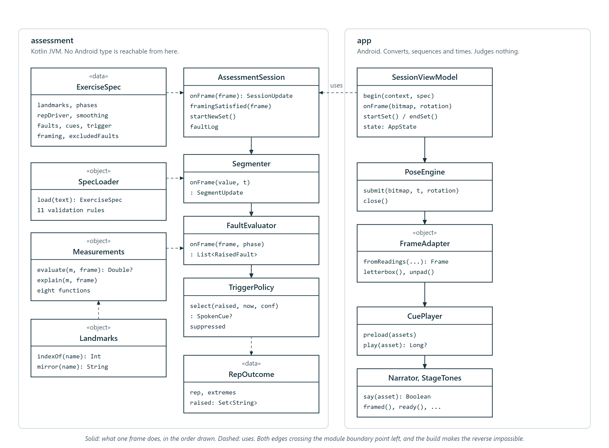
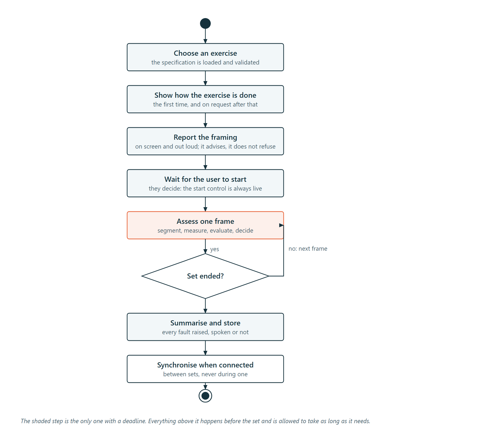
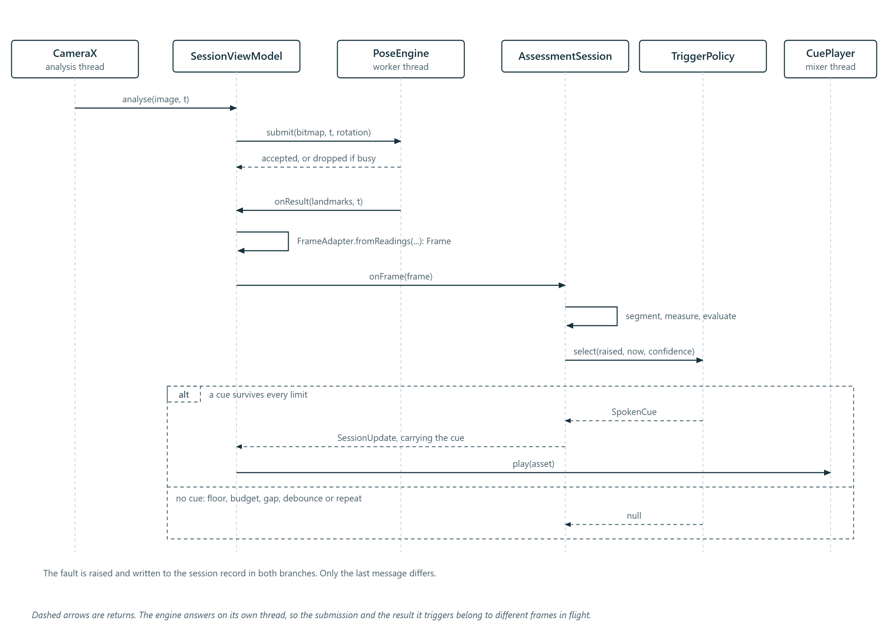
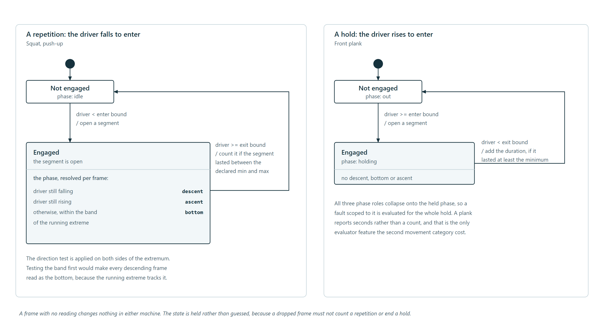

# Chapter 7 - Detailed Design

## 7.1 Class Design

**Figure 7.1** The two modules, with every dependency between them pointing in one direction. Nothing on the left can name a type on the right.

The left column is the assessment module, which is plain Kotlin. The right
column is the Android client. There is one edge between them and it points
leftward, from the client to the library.

**The specification, as loaded.**

**Table 7.1** The specification as loaded

| Type | Role |
|---|---|
| `ExerciseSpec` | The parsed file. Landmarks, framing, driver, phases, faults, cues, trigger, exclusions |
| `SpecLoader` | Parses and validates. Eleven rules, each failing with the rule named |
| `Landmarks` | Name to index, and the mirror of a name. The only type that knows the engine's layout |
| `Measurements` | The eight measurement functions, and the normalisers |

**The live assessment.**

**Table 7.2** The live assessment

| Type | Role |
|---|---|
| `AssessmentSession` | The one object the client talks to. Takes a frame, returns a `SessionUpdate` |
| `Segmenter` | Driver, smoothing, hysteresis, phases, counts and hold duration |
| `FaultEvaluator` | Continuous faults: the streak over the declared phases |
| `TriggerPolicy` | Which raised fault, if any, becomes a cue |
| `RepOutcome` | What one repetition came to, emitted at every closing boundary |

**The client.**

**Table 7.3** The client

| Type | Role |
|---|---|
| `SessionViewModel` | Sequences a session and holds the state the interface renders |
| `PoseEngine` | Loads the model, runs inference, drops a frame that arrives while busy |
| `FrameAdapter` | Letterbox and un-pad, presence floor, tensor to named landmarks |
| `CuePlayer`, `Narrator`, `StageTones` | Audio: the fault cues, the spoken stages, the non-verbal markers |

Two aspects of the arrangement carry most of its value.

**`AssessmentSession` is the only entry point.** The client does not reach
into the segmenter or the evaluator. It calls `onFrame` and receives a phase,
a count, the raised faults, and at most one cue. This is what makes the
assessment layer replaceable in one place, and it is what the offline replay
harness substitutes for.

**`Landmarks` is the only type that knows the engine's output layout.** The
specifications name landmarks as strings and every measurement resolves them
through this one table. Changing the pose engine changed this file and the
adapter, and reached no specification and no rule.

## 7.2 Activity Flow

**Figure 7.2** One session. Nothing before the set can send the trainee backwards; the only loop is the frame loop.

The flow has no gate in it. Before the set the system does two things and
blocks on neither: it shows how the exercise is performed, and it reports the
framing conditions in the specification, which are the required landmarks
visible above the floor and the body occupying a usable part of the frame.
When a condition fails the system names the correction needed on screen and
goes on naming it. Starting remains one tap throughout. Nothing is spoken
before the set except the line confirming it has started: the correction is
the same sentence the guide already shows, and a product that reads its own
screen aloud while the trainee is standing at it has misread who is where.

An earlier design refused to start until the framing passed. What defeats it
is the physical loop: the trainee presses start at the phone and then walks
into position, so the framing a pre-set gate measures is the framing of
somebody standing beside the camera. The gate was close to free of
information and it cost the product the posture of deciding whether a person
may train. What the condition genuinely bounds is what the assessment can
see, and that is handled where it bites: an unmeasurable landmark makes the
faults that need it unmeasured for those frames, which the record states, and
the set summary reports what was and was not seen.

Once the set starts it runs without interaction. The trainee's hands are
occupied and the screen faces away from them, so everything between the start
and the end of a set is audio, which NFR-U1 and NFR-U2 require.

At the end the system stops the pipeline, writes the record, and shows the
summary. The summary is the first thing in the whole flow that assumes the
trainee is looking at the screen.

## 7.3 Sequence: One Frame to One Cue

**Figure 7.3** One frame. Most frames take one of the early exits.

The sequence is worth reading for its exits rather than its happy path. A
frame can stop at the busy check, at the pose result, at the visibility floor,
at the phase scope, at the confirmation streak, at the confidence floor, or at
the rate limit. Each is a different reason, and the common case is that a
frame stops at one of them.

Three points in the sequence decide the latency the trainee experiences.

**The timestamp is taken at capture, not at arrival.** Everything downstream
measures from when the camera saw the movement rather than from when the
application got round to it, so a queueing delay cannot hide inside the
figure.

**The cue is a clip already in memory.** `CuePlayer.preload` loads every asset
the specification names when the session begins, so the path from a confirmed
fault to the first audible sample is a map lookup and a play call. There is no
file read and no synthesis in it, which is what makes the allocation in 3.4.1
met by construction.

**The record of what was spoken is taken from the audio layer**, not from the
decision to speak. The two differ whenever the policy suppresses, and keeping
them separate is what lets a set report six faults raised and two cues spoken
without the two numbers contradicting each other.

## 7.4 State Machines

**Figure 7.4** The same machine twice. Only the entry comparison and what is reported at the end differ.

The segmenter is one state machine with two configurations.

**Counting.** Idle until the driver falls below the entry bound; engaged until
it rises past the completion bound. On completion, the elapsed time is checked
against the declared bounds and the count advances if it passes. Within the
engaged state the phase is resolved from the direction of travel: falling is
the descent, rising is the ascent, and a driver that has stopped moving within
a band of its own extreme is the bottom.

**Holding.** The same machine with the entry comparison reversed. Entered when
the driver rises past its bound, left when it falls back under the other, and
the time accumulated rather than counted.

Three details in the implementation are worth naming.

**Stillness is tested against the measurement's own noise.** The bottom phase
is where the driver has stopped moving, which requires a threshold for what
counts as movement. That threshold has to sit above the frame-to-frame noise
of the pose estimate or the phase is never entered at all. It is a property of
the engine rather than of the movement, and 4.2.5 records what happened when
it was carried across an engine change unchanged.

**An unmeasurable driver does not reset the machine.** At the bottom of a
squat the ankle can leave the frame, and the driver stops resolving. The
segmenter holds its state and reports the phase it was in, rather than
treating a missing measurement as a return to idle. This is why the per
repetition evaluation mode samples every engaged frame instead of the frames
at the driver's extreme.

**The duration bounds are applied at the close, not during.** A segment is
only rejected once its length is known, so a trainee pausing mid-repetition is
not cut off partway through; the repetition simply does not count when it ends.

### 7.4.1 The declared phase conditions are not parsed

The specification describes each phase in prose: the bottom is *"driver at
local minimum, within 10 degrees of it"*. The evaluator does not parse that
sentence. The band is a constant in the segmenter, and the phase names in the
file are matched to roles by position.

This is a real gap between what the format appears to declare and what the
evaluator reads, and it is recorded rather than closed. The effect is bounded:
a new exercise in either supported category gets the same phase behaviour as
the existing ones whatever its prose says, and an exercise needing different
phase semantics needs an evaluator change and not only a file.

It is stated here because a reviewer reading the specification would otherwise
reasonably believe the sentence was executable.

## 7.5 Data Model

One record per set, written locally when the set ends.

**Table 7.4** The set record written when a set ends

| Field | Contents |
|---|---|
| `exercise`, `spec_id`, `spec_version` | Which exercise, and the version of the file in force |
| `started_at`, `ended_at`, `duration_s` | When the set ran, and how long it took |
| `reps` or `hold_s` | The result, by the exercise's declared scoring mode |
| `reps_with_fault` | How many repetitions carried any fault |
| `faults`, `cues` | Every fault raised, and every cue actually spoken, each with its timing |
| `reps_detail` | One row per repetition: its number, the measured value behind each per-repetition fault, and what was raised |
| `cues_spoken` | How many the trainee actually heard |
| `suppressed` | Why a raised fault did not become a cue, counted by reason |
| `measured` | Per fault, the range of values seen and how many frames were measurable |
| `pose_rate`, `fps` | The coverage behind the whole record |

**`spec_version` is what makes an old record readable.** A fault code means
what the specification of that version said it meant. A record without its
version becomes uninterpretable the first time a threshold moves, and
thresholds in this project have moved.

**`reps_detail` stores the value for every repetition, including the ones that
passed.** A count of faults answers how many and not which, and it cannot
distinguish a set of repetitions that were comfortably correct from a set that
passed by a hair. The per-repetition value is what makes a later reader able
to tell those apart, and it is what the evaluation in 9.4 is computed from.

**`pose_rate` is kept because it qualifies everything else.** A set in which
the engine lost the body for a quarter of its frames has a repetition count
and a fault count that mean less than the same numbers from a set with full
coverage. Storing it means the qualification travels with the record instead
of being lost. `suppressed` and `measured` are there for the same reason from
the other direction: a quiet set and a set that detected nothing look
identical without them.

Records are held in application-private storage. Nothing else about a session
is written: no frame, no still image and no landmark sequence. That is what
NFR-S1 asserts, and a reader can check it by looking for a write path and
finding none.
