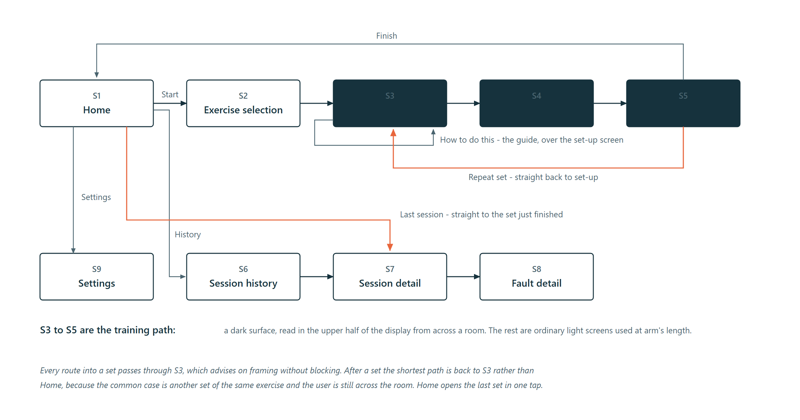

# Chapter 8 - UI/UX Design

## 8.1 Design Principles

The interaction model here is unusual, and the unusual part drives every
decision in this chapter: **during the activity the product is designed for,
the trainee can neither look at the screen nor touch it.** They are mid-squat,
two to four metres away, facing a direction the designer does not control.

Five principles follow.

**P1. Audio is the primary output during a set; the screen is secondary.**
Anything that must reach the trainee mid-repetition is spoken. The display
carries only what survives a one-second glance from three metres: the
repetition count, and whether the system is tracking.

**P2. All configuration happens before the set and none during it.** Exercise
selection, setting up and settings are pre-set activities. Once a set starts
the only interaction available is ending it, which is NFR-U1.

**P3. Everything the trainee has to get right is said before the set, and
nothing is withheld until they get it right.** Before the first set of an
exercise the product shows the position it measures against, where to put the
phone, and what each cue will ask for. During set-up it reports the framing
and keeps reporting it. It does not refuse to start: 7.2 gives the reason,
which is that the trainee presses start at the phone and then walks into
position, so a gate there grades the wrong moment.

**P4. The posture is the device standing unaided, folded to ninety degrees.**
The target handset does this without a tripod, which is why none is required.
The camera and the main display face the trainee together, and **only the
upper half of the display is visible in that posture**, so every screen places
what the trainee must see in the upper half. The constraint is held in the
layouts rather than drawn on them.

**P5. Nothing is shown that was not measured.** Where the interface shows a
number, it shows what that number is. A repetition count is a count and a
fault count is a count. No accuracy percentage, confidence score or overall
form score appears anywhere, because no such figure could be defended.

**Physical constraints are design inputs rather than afterthoughts.** The
viewing distance is two to four metres, so type must be large. Hands may be
sweaty and the trainee out of breath, so pre-set targets must be large and
few. Ambient lighting is uncontrolled, so contrast must be high. The room may
be noisy, which is why headphones are assumed.

## 8.2 Screen Inventory

**Table 8.1** The nine screens, and what each one is for

| # | Screen | Purpose |
|---|---|---|
| S1 | Home | Start a set, or open history |
| S2 | Exercise selection | Choose from the exercises whose specifications are loaded |
| S3 | Set-up | Live preview with the specific correction needed, and the guide to the exercise |
| S4 | Live session | Repetition count, tracking state, end control |
| S5 | Set summary | Repetitions, faults and counts, immediately after the set |
| S6 | Session history | Reverse chronological list |
| S7 | Session detail | Per-set breakdown |
| S8 | Fault detail | Plain-language description, the cue spoken, what to do differently next time, and the source of the definition |
| S9 | Settings | A sound check before a set |

Three of these exist because of commitments made elsewhere in the report.

**S3 exists because of FR-02 and FR-28.** What it shows is the specific
correction rather than a generic failure: move further back, turn side on. A
screen that said only "framing not usable" would leave the trainee to guess.
It also carries the guide, which opens over it on the first set of an
exercise and is reachable from it afterwards. The guide is the one place the
product explains the movement instead of judging it. The diagram on it draws
the line the faults are measured against, so the standard is visible before it
is applied.

**S8 exists because of O5.** Every fault the system can raise traces to a
published criterion, and S8 is where that reaches the trainee. It shows the
plain-language description, the cue that was spoken, what to do differently
next time, and where the definition came from. A system that asserts a fault
without being able to say why it is a fault has not earned the correction,
and one that says what is wrong without saying what to do about it has
stopped half way.

**The source is shown in a sentence, not as a citation.** The specification
carries both: the reference, with authors, journal and the quoted criterion,
and the same claim written for somebody holding a phone. The screen shows the
second. The first belongs in this report. An earlier build printed the
opening of it on screen and the line ended mid-clause, which is what a
citation looks like in a place it does not fit.

**S9 exists for one reason the trainee can act on.** The product corrects out
loud, and their headphones, their volume and their silent switch are three
things it depends on entirely and cannot see. Finding out mid-set that the
phone was muted costs them the set, so the screen is a sound check and little
else.

Everything else that screen used to carry, including the loaded specification
versions, was written for a reviewer rather than for a trainee and has been
removed. The provenance of a fault reaches the user through S8, where it is
attached to a correction they actually heard, which is the only place it means
anything to them.

## 8.3 Screen Flow

**Figure 8.1** The training path across the top and the history path below. The two accented edges are the shortcuts: back to set-up after a set, and straight from Home into the set just finished.

Three properties of the flow are deliberate.

**Set-up is on the path and cannot be bypassed, but it cannot block
either.** Every route into a set passes through it, so the framing is always
reported and the guide is always one tap away; neither is a condition of
starting.

**After a set, the shortest path is back to set-up rather than to Home.** The
common case after a set is another set of the same exercise, and the trainee
is still across the room. Routing them through Home would make the most
frequent action the longest one. The guide does not reopen on a repeat: they
have just done the exercise.

**Home opens the last set directly, without going through the list.** The
card on Home already names that set, and somebody who has just finished
training and picked the phone back up wants that one set far more often than
they want every set they have ever done. Making them pass through S6 to
reach a record S1 was already showing them is the list existing for its own
sake. S6 remains the only route to everything else, and S7 knows which way
it was entered so that back goes where the trainee came from.

## 8.4 Visual Language

The design file is built on **bound design tokens rather than literal
values**: fourteen colour variables, eight spacing steps, four radii and a
ten-step type ramp, each bound in the file rather than typed into a shape.
The colour meanings asserted here are therefore enforced by the file instead
of merely described by it.

**Colour carries exactly one meaning, and it is state.** A fault is warm, a
pass is cool, and everything structural is neutral. Nothing is coloured for
decoration, because a palette that colours both decoration and state cannot be
read at a glance from three metres, which is the only reading condition that
matters during a set.

**Type is sized for distance rather than for density.** The repetition count
is the largest element on the live screen by a wide margin, because it is the
one number the trainee may glance at mid-set. Everything else on that screen
is deliberately subordinate.

## 8.5 Prototype

A navigable prototype covering S1 through S9, built in Figma across three
pages: the brand, the screens at 412 by 990, and the screen flow. That is the
common Android reference frame, not a measurement of the target handset. The
handset's main display is 1080 by 2640 physical pixels, which is 384 by 939
device-independent pixels at the display density set on the test device, so
the prototype is drawn a little larger than the screen it is for. Ten artboards cover the nine
screens, because S3 has two states worth drawing: the set-up screen and the
guide that opens over it. The guide's artboard is taller than
a handset screen, which is deliberate: it scrolls, and drawing it at 990
would have shown a button cut in half rather than a sheet.

**The guide shows a photograph, not a drawing.** The first version drew the
line each rule measures against, which is a useful thing for a diagram to do
and not what somebody about to train wants to look at. Every photograph the
product ships is licensed for it, and `docs/assets/ui/CREDITS.md` records the
source, the author and the licence of each. The squat shown here is by Matt
Moloney on StockSnap, released under CC0.

**Figure 8.2** The nine screens, with the guide that opens over S3. The training path is laid out for the upper half of the display, which is what the folded posture leaves visible.

**What the prototype demonstrates.** The flows, the information hierarchy,
and the screen states, including the two that are easiest to leave
undesigned: framing that needs correcting, and a fault that has no authored
cue. Both are states the system genuinely reaches, and both have a designed
appearance rather than an undefined one.

**What the prototype cannot establish, and what was checked on the device
instead.** Legibility at three metres and usability while out of breath are
properties of the handset in the real posture, not of a design file. Both
were checked on the target device. The repetition count and the tracking state
were readable at three metres in a glance, and the controls were operable
immediately after a set taken to near failure.
This is one person on one device, so it is an observation and not a
usability study; what it rules out is the failure that would have mattered
most, which is type sized for a desk and controls sized for a steady
hand.

This is the bar the supervisor set for this phase: a UI/UX demonstration is
sufficient evidence of the product surface, and it does not need a shipped
application behind it.
